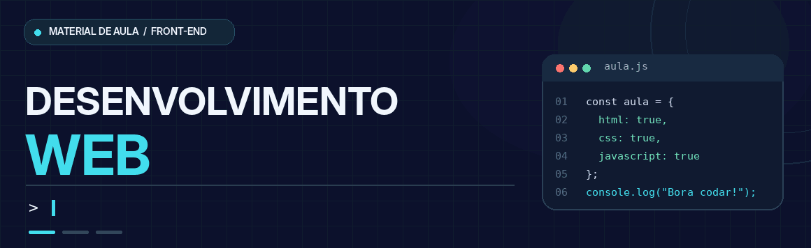
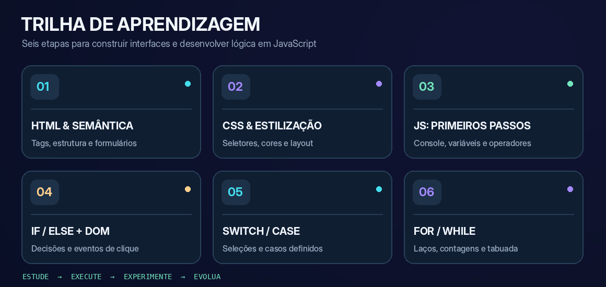
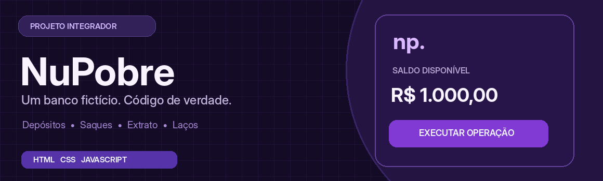

<div align="center">



<br>


<br>

**Um espaço para aprender desenvolvimento web de forma progressiva: da primeira página HTML aos projetos interativos com JavaScript.**

Material de apoio da disciplina **Desenvolvimento Web**, com exemplos de aula, exercícios práticos e desafios de lógica.

[**📚 EXPLORAR AS AULAS**](#-trilha-de-aulas) &nbsp;•&nbsp;
[**💻 EXEMPLOS PRÁTICOS**](#-laboratório-de-código) &nbsp;•&nbsp;
[**🏦 PROJETO INTEGRADOR**](#-projeto-integrador--nupobre)

</div>

---

## 🎯 O que você vai aprender

Aqui, o aprendizado acontece **por etapas**: entender o conceito, testar um exemplo e modificar o código até descobrir como ele funciona.

<table>
<tr>
<td width="33%" valign="top">

### 01 · Estrutura
**HTML**

Organizar o conteúdo de uma página com elementos semânticos, links, imagens, listas, tabelas e formulários.

</td>
<td width="33%" valign="top">

### 02 · Aparência
**CSS**

Trabalhar com estilos, classes, seletores, espaçamentos, cores e organização visual de páginas.

</td>
<td width="33%" valign="top">

### 03 · Interatividade
**JavaScript**

Criar comportamentos com variáveis, condições, eventos, laços de repetição e manipulação de elementos HTML.

</td>
</tr>
</table>

## 🗺️ Trilha de aulas

<div align="center">

</div>

> **Como estudar:** siga a sequência abaixo. Cada aula possui arquivos práticos que podem ser abertos, executados e alterados para testar os conceitos.

| Etapa | Conteúdo | O que você pratica | Material |
|:---:|---|---|:---:|
| `01` | **Introdução ao HTML** | Estrutura de documentos, textos, links, imagens, tabelas e formulários | [**Abrir aula →**](./Aula%2001%20HTML/) |
| `02` | **Introdução ao CSS** | Seletores, cores, fontes, espaçamentos e estilização de páginas | [**Abrir aula →**](./Aula%2002%20CSS/) |
| `03` | **Fundamentos de JavaScript** | `console.log`, variáveis, operadores, tipos e comparações | [**Abrir aula →**](./Aula%2003%20JS/) |
| `04` | **JavaScript com HTML** | Eventos, acesso ao DOM e condições com `if / else` | [**Abrir aula →**](./Aula%2004%20JS%20no%20HTML/) |
| `05` | **Múltiplas condições** | `switch / case` aplicado a dias da semana e produtos de uma lanchonete | [**Abrir aula →**](./AULA%2005%20JS%20NO%20HTML-2/) |
| `06` | **Laços de repetição** | `for`, `while`, contagem regressiva e geração de tabuada | [**Abrir aula →**](./AULA%2006%20-%20WHILE%20E%20FOR/) |

## 💻 Laboratório de código

Escolha um exemplo, abra seus arquivos e experimente alterar entradas, condições e resultados.

| Exemplo | Conceito principal | Acessar |
|---|---|---|
| **Verificação de maioridade** | `if`, `else if`, `else` e atualização de texto | [Código](./Aula%2004%20JS%20no%20HTML/if-else.js) · [HTML](./Aula%2004%20JS%20no%20HTML/if-else.html) |
| **Dias da semana** | Seleção de opções com `switch / case` | [Código](./AULA%2005%20JS%20NO%20HTML-2/switch_case.js) · [HTML](./AULA%2005%20JS%20NO%20HTML-2/switch_case.html) |
| **Lanchonete** | `switch / case` aplicado à escolha de produtos | [Código](./AULA%2005%20JS%20NO%20HTML-2/lanchonete.js) · [HTML](./AULA%2005%20JS%20NO%20HTML-2/lanchonete.html) |
| **Contador com `for`** | Repetição e criação de itens na página | [Código](./AULA%2006%20-%20WHILE%20E%20FOR/for.js) · [HTML](./AULA%2006%20-%20WHILE%20E%20FOR/for.html) |
| **Contagem com `while`** | Condição de repetição e decremento | [Código](./AULA%2006%20-%20WHILE%20E%20FOR/while.js) · [HTML](./AULA%2006%20-%20WHILE%20E%20FOR/while.html) |
| **Tabuada interativa** | `for`, entrada de dados e manipulação do DOM | [Código](./AULA%2006%20-%20WHILE%20E%20FOR/Exerc%C3%ADcio/tabuada.js) · [HTML](./AULA%2006%20-%20WHILE%20E%20FOR/Exerc%C3%ADcio/index.html) |

<details>
<summary><b>🔎 Dica de estudo: como analisar um exemplo JavaScript</b></summary>

1. Identifique quais elementos HTML o código acessa com `document.getElementById()`.
2. Encontre o evento que inicia a execução, como `addEventListener("click", ...)`.
3. Observe quais variáveis recebem os dados informados pelo usuário.
4. Entenda a condição ou repetição responsável pelo resultado.
5. Modifique um valor e teste novamente — aprender programação exige experimentação.

</details>

## 🏦 Projeto integrador — NuPobre

<a href="./DESAFIO%20DO%20BANCO/"></a>

Depois dos fundamentos, é hora de combinar os conhecimentos em uma aplicação.

O **NuPobre** é um simulador bancário **fictício e educacional**, feito com HTML, CSS e JavaScript. Nele, os conceitos deixam de aparecer isoladamente e passam a trabalhar juntos.

| Funcionalidade | Conceito praticado |
|---|---|
| Consultar saldo, depositar ou sacar | `switch / case` |
| Conferir entradas e validar operações | `if / else` |
| Calcular a quantidade de cédulas de um saque | `while` |
| Percorrer o histórico de movimentações | `for` |
| Atualizar resultados na interface | DOM e eventos |

<div align="center">

[](./DESAFIO%20DO%20BANCO/)
[](./DESAFIO%20DO%20BANCO/script.js)

</div>

> O projeto é uma simulação para fins de aprendizagem. Não realiza transações financeiras reais e não utiliza banco de dados.

## 🚀 Comece por aqui

### 1. Baixe o material

Use o botão verde **Code → Download ZIP** na página do repositório ou clone pelo terminal:

```bash
git clone https://github.com/Vinicius-Tessari/Desenvolvimento-Web.git
cd Desenvolvimento-Web
```

### 2. Abra a aula desejada

Abra a pasta do projeto no **Visual Studio Code** e escolha o assunto que deseja estudar. Cada pasta contém os arquivos usados na respectiva aula.

### 3. Execute no navegador

- Para exemplos com interface, abra o arquivo **`.html`** correspondente no navegador.
- Para a aula de fundamentos do JavaScript, abra `Aula 03 JS/index.html`, pressione **F12** e selecione **Console** para visualizar as saídas.
- Para o simulador bancário, abra `DESAFIO DO BANCO/index.html`.

**Não é necessário instalar Node.js, frameworks ou banco de dados** para executar os exemplos deste repositório.

### 4. Modifique e experimente

Altere textos, valores, condições e repetições. Execute novamente e compare os resultados.

```javascript
// Experimente no Console do navegador
let numero = 1;

while (numero <= 5) {
    console.log("Contagem:", numero);
    numero++;
}
```

## ✅ Boas práticas de estudo

- **Entenda antes de copiar:** identifique a finalidade de cada comando.
- **Teste no navegador:** use o Console e verifique mensagens de erro.
- **Avance por etapas:** domine HTML, CSS e lógica antes de combinar tudo.
- **Organize seu código:** nomes claros, indentação e arquivos bem separados.
- **Experimente variações:** altere as condições para observar comportamentos diferentes.

## 🔗 Referências para consulta

| Assunto | Documentação |
|---|---|
| HTML | [MDN — HTML](https://developer.mozilla.org/pt-BR/docs/Web/HTML) |
| CSS | [MDN — CSS](https://developer.mozilla.org/pt-BR/docs/Web/CSS) |
| JavaScript | [MDN — JavaScript](https://developer.mozilla.org/pt-BR/docs/Web/JavaScript) |
| JavaScript no navegador (DOM) | [MDN — DOM](https://developer.mozilla.org/pt-BR/docs/Web/API/Document_Object_Model) |
| Git | [Documentação do Git](https://git-scm.com/doc) |
| GitHub | [GitHub Docs](https://docs.github.com/pt) |

---

<div align="center">

### 👨‍🏫 Professor responsável

**Vinicius Tessari**

Desenvolvimento Web · Conteúdo didático e prática de programação

[](https://github.com/Vinicius-Tessari)

<br>

<sub>Aprender a programar é entender o que o código faz — não apenas fazer o código funcionar.</sub>

</div>
